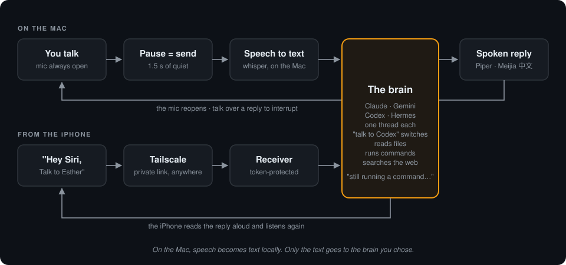

<div align="center">

# Voice Desk

**Talk to Claude Code, Gemini and your Hermes agents like a phone call. One voice line, hands-free, on your Mac and your iPhone.**

<table>
<tr>
<td width="40%" valign="middle">

</td>
<td width="60%" valign="middle">

</td>
</tr>
<tr>
<td align="center"><sub><b>On the iPhone.</b> "Hey Siri, Talk to Claude", then a question. Eleven seconds later Siri reads out an answer that came from Claude Code running on the Mac.</sub></td>
<td align="center"><sub><b>On the Mac.</b> The window: a coloured light, a live mic meter, and the transcript. Same conversation as the phone.</sub></td>
</tr>
</table>

    

</div>

You speak. When you pause, it sends. Claude does the work and **answers out loud**. Then
the microphone opens again for your next sentence. There's no record button, no play
button and no typing.

This isn't a chatbot with a voice bolted on. It is **the real Claude Code**, with your
files, your terminal and the web, driven by your voice. And it is a desk with more than one
person behind it: say "talk to Gemini" or "talk to Esther" (a [Hermes](https://github.com/NousResearch/hermes-agent)
profile) and the same line carries on with that brain's own separate conversation. Ask it to count the lines in a
project, check why a job failed, or look something up. While it works it tells you what
it's doing ("still running a command"), so you're never left in silence. Away from the
desk, the same conversation continues on your iPhone through Siri.

## Why you'll like it

- **Truly hands-free.** The mic stays open. A 1.5-second pause is your "send" button.
- **It does real work.** Every turn is a full Claude Code turn: it can read, run, edit and search.
- **Talk over it.** Start speaking while it answers and it stops to listen.
- **One conversation, two devices.** Start at your desk, carry on from your iPhone with
  "Hey Siri, Talk to Claude". Both continue the same thread.
- **Your voice stays on your Mac.** Speech recognition runs locally with whisper.cpp.
  Only the transcribed text goes to Claude.
- **Bilingual.** Speak English or Mandarin, and get the answer back in the same language.
- **No API key.** It uses the `claude` command you're already logged into, on your normal subscription.
- **Change things by voice.** "Use Opus", "think deep", "go to sleep", "goodbye".
- **More than one brain.** Gemini and every [Hermes](https://github.com/NousResearch/hermes-agent) profile
  on the Mac are on the same line. Say "talk to Gemini" or "talk to Esther" and the window and the
  phone carry on with that brain's own thread.

---

## See it

The window is deliberately tiny: a coloured light that tells you what's happening, a
live mic meter, and the transcript. These are screenshots of the real app, replaying a
conversation recorded from real Claude turns.

<table>
<tr>
<td width="50%"><br><b>Listening.</b> The mic is open. Just start talking.</td>
<td width="50%"><br><b>Hearing you.</b> The meter jumps when it picks up your voice.</td>
</tr>
<tr>
<td><br><b>Thinking.</b> Claude is working. Every 10 seconds it says what it's doing.</td>
<td><br><b>Speaking.</b> The answer is read aloud. Talk over it to interrupt.</td>
</tr>
<tr>
<td><br><b>中文 works too.</b> Ask in Mandarin, hear the answer in a Taiwan Mandarin voice.</td>
<td><br><b>Asleep.</b> After a minute of quiet it naps. Say "hey Claude" to wake it.</td>
</tr>
<tr>
<td colspan="2"><br><b>More than one brain.</b> "Talk to Esther" hands the line to a Hermes profile with its own memory of what you said; the corner label and the transcript follow. "Talk to Gemini" and "talk to Claude" work the same way.</td>
</tr>
</table>

## How it works



Each step is one small Python file:

| Step | File | What it does |
|---|---|---|
| Listen | `audio.py` | Keeps the mic open and compares loudness with a background-noise level that adjusts itself. 0.25 s of sound starts a recording, 1.5 s of quiet ends it, and anything shorter than 0.4 s is ignored as a cough. No speech library needed. |
| Transcribe | `stt.py` | `whisper-server` stays loaded, so each turn takes about 1.3 s instead of reloading the model every time. It filters out whisper's habit of hallucinating "Thank you." from silence. |
| Think | `brain.py` | Runs `claude -p --resume <thread>` with a short instruction to *answer like a phone call*: one to four spoken sentences, with no code, paths or links. Long detail goes to a file instead. A file lock lets the Mac and the phone take turns on one thread. |
| Speak | `tts.py` | Strips markdown, picks an English or Mandarin voice, and plays the answer in a way that can be cut off instantly. |
| Loop | `engine.py`, `app.py` | Runs the cycle, spoken commands and sleep/wake. A [Textual](https://textual.textualize.io) window draws the light, meter and transcript. |
| Phone | `receiver.py` | A tiny token-protected web endpoint the iPhone Shortcut calls: `POST /ask` takes the question and answers within 8 s if it can; `GET /reply` hands out each finished answer exactly once, so the phone can check back on a fixed schedule and never keeps Siri waiting. |

**Measured on a 24 GB Apple Silicon Mac:** speech to text 1.2–1.6 s, a simple Claude turn
4–11 s, a turn that digs through files about 20 s, voice synthesis 2.7–4 s.

---

## Quick start

You need a Mac (Apple Silicon recommended), [Claude Code](https://claude.com/claude-code)
installed and logged in, and [Homebrew](https://brew.sh).

```bash
# 1. tools: local speech recognition + audio conversion
brew install whisper-cpp ffmpeg

# 2. the speech model (~490 MB, one time)
mkdir -p ~/.local/share/whisper-models
curl -L -o ~/.local/share/whisper-models/ggml-small.bin \
  https://huggingface.co/ggerganov/whisper.cpp/resolve/main/ggml-small.bin

# 3. the app
git clone https://github.com/Panbear1983/Voice_Desk.git && cd Voice_Desk
uv venv .venv --python 3.11          # or: python3.11 -m venv .venv
uv pip install --python .venv/bin/python -r requirements.txt

# 4. check every stage works (no mic, no window, no Claude tokens)
.venv/bin/python tests/selftest.py --no-brain

# 5. go
./start.sh
```

The first time it opens, macOS asks whether Terminal may use the microphone. Click
**Allow**. Wait for "I'm listening" and start talking.

## Talk to it

| Say | What happens |
|---|---|
| *anything, then pause* | sent to Claude |
| "stop", "wait", "hold on", 「等一下」 | cuts the answer off (or just start talking over it) |
| "go to sleep", 「休息」 | stops listening until you say a name ("hey Claude", "Jarvis", …) |
| "hey Claude, …" | wakes it up; the rest of the sentence is your question |
| "Jarvis, …" / "hey Kylie" / "Esther, …" / "Wanna Buffet, …" | wakes it **and** puts that brain on the line: Jarvis = the orchestrator, Kylie = the assistant, Esther = tax_angel_esther, Wanna Buffet = wanna-buffet ([Hermes](https://github.com/NousResearch/hermes-agent) profiles). The rest of the sentence is the question; the confirmation uses the name ("Jarvis here.") |
| "mute" / "unmute" | the always-on listener ignores everything until "unmute" (or <kbd>M</kbd> in the dashboard) |
| "use Opus" / "switch to Sonnet" / "use Haiku" / "use Fable" | changes the model from the next question on |
| "which model" | tells you which model it's using |
| "think deep" / "quick mode" / "max effort" / "normal mode" | how hard Claude thinks |
| "which effort" | tells you the current effort level |
| "talk to Gemini" / "talk to Jarvis" / "talk to Kylie" / "talk to Esther" / "talk to Wanna Buffet" / "talk to Claude" | switches to another brain, each with its own separate conversation: Gemini, and every [Hermes](https://github.com/NousResearch/hermes-agent) profile on the Mac |
| "who am I talking to" / "who can I talk to" | which brain is on, and the list |
| "open mic" / "tap to talk" | switches listening mode (tap mode is for noisy rooms) |
| "goodbye", 「再見」 | ends the session; Claude saves a short note about what you discussed |

Ending a sentence with "over" or "send" also works, and the word is dropped.

## Always on: just say a name

The window is for a sit-down conversation. For the rest of the day there is a listener that
runs in the background from login, with no window and no keyboard:

```bash
./install_listener.sh      # login job com.peter.voice-desk-listener; starts it now
./dashboard.sh             # small control panel for it
```

It sleeps with the microphone open and reacts only to a sentence that **starts with a
name**: "Jarvis, what time is it?" runs one turn with Jarvis, speaks the answer and goes back
to sleep. "Hey Kylie" on its own gets "Kylie here." and ten seconds to ask. A name in the
middle of a sentence ("I told Jarvis yesterday") is ignored. Everything is transcribed on
the Mac; only a sentence that starts with a name goes anywhere. The threads are the same ones
the window and the phone use.

It never hears itself: the mic is deaf while it speaks and for a second after, and also
while any other program on the Mac is speaking (`afplay` / `say`, which is how the Claude
read-aloud hook and Hermes voice mode talk). It holds `~/.voice_desk/window.lock`, so the
read-aloud hook stays silent while it runs, and the window and the listener never share the
mic: open the window and the listener waits (light: *standby*) until you close it.

The dashboard never touches the mic. It reads `~/.voice_desk/listener.json` and shows the
light (asleep · listening · hearing · thinking · speaking · muted), who is on the line, the
last thing heard and the last reply, plus every agent's voice (from `agents.toml`) and a
warning if a profile drifted from it. Keys: <kbd>M</kbd> mute/unmute · <kbd>H</kbd> hush ·
<kbd>N</kbd> new conversation · <kbd>V</kbd> per-agent voices / one shared voice ·
<kbd>R</kbd> restart the listener · <kbd>K</kbd> stop it ·
<kbd>Q</kbd> close the panel (the listener keeps running).

**Keys** (you never *need* them): <kbd>Space</kbd> talk in tap mode or interrupt ·
<kbd>M</kbd> mode · <kbd>S</kbd> sleep/wake · <kbd>N</kbd> new conversation · <kbd>Q</kbd> quit.

## Take it to your iPhone

Same conversation, from anywhere, through [Tailscale](https://tailscale.com) (free for
personal use), which privately links your phone and your Mac.

```bash
./install_receiver.sh                   # starts the receiver now and at every login
.venv/bin/python make_shortcut.py       # builds a signed "Talk to Claude.shortcut"
```

Get the `.shortcut` file onto the phone (AirDrop, iCloud Drive, or send it to yourself)
and tap **Add Shortcut**. Then say **"Hey Siri, Talk to Claude"**. It listens, sends what
you said when you pause, reads the reply aloud and listens again, for up to 300 rounds.

Siri drops any request that takes more than about ten seconds, and a Claude turn can take
twenty or more, so the phone never waits for a whole turn: the Mac takes the question at
once and the Shortcut checks back every few seconds, saying "still running a command"
while it waits, then speaks the answer the moment it is ready. Rebuild the Shortcut and
re-add it whenever you change the receiver.

Prefer typing on the phone? `./install_remote_control.sh` keeps a Claude Code Remote
Control session running on the Mac, so the Claude app on your phone always finds it.

## More than one brain

**Gemini** joins if Google's Antigravity command-line tool (`agy`, the replacement for the
retired Gemini CLI, on a normal Gemini subscription) is installed and signed in. "Talk to
Gemini" starts or continues one Gemini conversation; `GEMINI_MODEL` in `settings.py` picks the
model (`agy models` lists them, Gemini 3.8 Flash by default).

**Hermes.** If [Hermes Agent](https://github.com/NousResearch/hermes-agent) is installed, every profile
under `~/.hermes/profiles` is a separate thread you can talk to, with its own memory of
what you said. Nothing to configure: the profiles are found at start.

- **In the window:** "talk to Esther", "talk to the orchestrator", "talk to Claude". Any
  word of the profile's name works (`tax_angel_esther` answers to "Esther"). The label in the
  corner and in the transcript shows who is on. <kbd>N</kbd> starts a fresh thread with
  whoever that is.
- **From the phone:** one Shortcut per brain, pinned to it, so the wake phrase picks the
  thread: `make_shortcut.py --to esther` builds "Talk to Esther", `--all` builds one for
  every brain. "Hey Siri, Talk to Esther" and "Hey Siri, Talk to Claude" never mix.

<p align="center"><br><sub>One Shortcut per brain on the iPhone. Each is a Siri phrase.</sub></p>

Each Hermes turn runs that profile headlessly (`hermes -p <profile> -z … --resume <id>`),
in its own home, with its own model, tools and memory. The session id is kept per profile in
`~/.voice_desk/hermes_sessions/`. Spoken names and their spellings live in `agents.toml`.

## Make it yours

**Voices, names and the mic: `agents.toml`.** One file owns everything voice-related for every
agent: each agent's spoken names (and the spellings whisper produces), reply voice and Mandarin
voice, speed, voice-mode knobs, the greetings that wake an agent ("hey", "hi", "hello"…), the
whisper hint words, the end phrases that close a voice chat, and the microphone sensitivity
(`[shared.mic]`). Change a value there, then:

```bash
.venv/bin/python -m voicecfg check              # what differs from the live settings (read-only)
.venv/bin/python -m voicecfg sync --dry-run     # the exact line changes it would make
.venv/bin/python -m voicecfg sync --apply       # back up, write, re-read with Hermes' own parser
```

`sync` writes each Hermes agent's values into `~/.hermes/profiles/<profile>/config.yaml`, so
the agent's own window **and** its Telegram voice bubbles use the same voice, and Claude's into
`~/.claude/voice-defaults.conf`, which the Claude read-aloud hook already reads. It edits single
lines only (comments and every other setting stay as they were), backs every file up to
`~/.hermes/profile-backups/<date>-voicecfg/` first, and puts a file back at once if Hermes cannot
read the result. Hermes reads voice settings when a session starts: reopen the agent's window,
and restart the Telegram gateway from a separate terminal, to hear a change. The listener reads
names, greetings, hint words and mic settings at start (restart it after changing those); voices
are read fresh before every spoken line. The dashboard lists every agent's voice and warns when a
profile was hand-edited away from `agents.toml`.

Esther keeps her own Kokoro voice everywhere: Voice Desk speaks her lines through her script
(`command` in her block), with an Edge voice (`fallback`) only if Kokoro fails.

Everything else adjustable is a plain constant in `settings.py`:

| Setting | Default | Change it to… |
|---|---|---|
| `SLEEP_AFTER_SEC` | `60` | nap sooner or later |
| `WHISPER_MODEL` | small | `large-v3-turbo` is more accurate but about 3× slower |
| `DEFAULT_MODEL` / `DEFAULT_EFFORT` | Fable / medium | your usual model |
| `TTS_VOICE_ZH_MAC` | Meijia | any Mac voice (`say -v '?'` lists them) |
| `TTS_CHAIN` / `TTS_ORDER` | optional script | your own voice pipeline (Piper, Edge…); without it, the built-in Mac voice speaks |
| `WAKE_WORDS`, `STOP_WORDS`, … | see file | your own phrases, in any language |
| `ECHO_TAIL_SEC` | `1.0` | how long the listener stays deaf after any speech ends |

Claude calls you by the first name on your Mac account. Set `VOICE_DESK_NAME` to
change it. Other environment overrides: `VOICE_DESK_STATE`, `VOICE_DESK_TTS_ORDER`,
`VOICE_DESK_CLAUDE_BIN`, `VOICE_DESK_WHISPER_PORT`, `VOICE_DESK_RECEIVER_HOST`,
`VOICE_DESK_RECEIVER_PORT`, `VOICE_DESK_AGENTS` (another `agents.toml`).

## Safety, in plain words

- **Claude runs with full permissions.** It won't stop to ask before running a command,
  which is what makes hands-free possible. Treat it like a trusted terminal you control by voice.
- **The phone receiver is only as safe as its token.** By default it listens on your home
  network and Tailscale. Anyone with the token who can reach your Mac could talk to Claude
  as you. The token is random, kept in a private file and inside the Shortcut, and never
  committed. To allow Tailscale only, set `VOICE_DESK_RECEIVER_HOST` to your Mac's
  Tailscale address. To rotate the token, delete `~/.voice_desk/receiver_token`, restart
  the receiver and rebuild the Shortcut.
- **It won't hear itself.** Each voice turn sets `VOICE_DESK_LOOP=1`, so Claude Code hooks
  can skip anything that would speak twice. While the window or the always-on listener runs,
  it holds `~/.voice_desk/window.lock`, which other read-aloud hooks can check. That stops the
  open mic from mistaking another session's spoken answer for you.
- **The always-on listener is a microphone that is always open.** Nothing leaves the Mac
  unless a sentence starts with a name, but whisper still hears the room. Say "mute", press
  <kbd>M</kbd> in the dashboard, or <kbd>K</kbd> to stop it.

<details>
<summary><b>Where things are kept</b></summary>

Nothing personal lives in the repo. The app's memory is `~/.voice_desk/`:

| File | Holds |
|---|---|
| `session_id` | the shared conversation thread |
| `model`, `effort` | your spoken model / effort choice |
| `receiver_token` | the phone's password (owner-only) |
| `transcript.log` | every question and answer, time-stamped |
| `detail.md` | long answers Claude chose not to read aloud |
| `window.lock`, `turn.lock` | "window or listener has the mic" and "turn running" markers |
| `listener.json` | the always-on listener's state, for the dashboard |
| `muted` | present while the listener is muted |
| `listener.log` | the listener's log: one line per turn |
| `receiver.log`, `remote-control.log` | background job logs |

</details>

<details>
<summary><b>Troubleshooting</b></summary>

| Symptom | Fix |
|---|---|
| Mic meter stays at 0 | System Settings → Privacy & Security → Microphone → allow your terminal |
| "already open in another window" | only one window at a time; close the other |
| Light stuck on *hearing you* | room too loud for open mic; press <kbd>M</kbd> for tap mode |
| It answers things you didn't say | something else on the Mac is talking; mute it or use tap mode |
| Dashboard light says *off* | the listener is not running: <kbd>R</kbd> in the dashboard, or `./install_listener.sh`; `~/.voice_desk/listener.log` says why |
| "The always-on listener has the microphone" | the listener is running; <kbd>K</kbd> in the dashboard stops it if you want the window |
| Siri says "something went wrong" | Tailscale off on the phone, or the receiver isn't running (`curl http://<mac-tailscale-ip>:8765/health`); `~/.voice_desk/receiver.log` has one line per request. An old Shortcut built before the check-back design times out on long answers: rebuild and re-add it |
| A new conversation started by itself | you opened the voice thread in another `claude --resume` window and left it open; read it, then quit |
| Slow to start speaking | your `TTS_ORDER` tries a voice that keeps failing first; reorder it |

</details>

<details>
<summary><b>Testing and regenerating these screenshots</b></summary>

```bash
.venv/bin/python tests/selftest.py              # every stage, including two real Claude turns
.venv/bin/python tests/selftest.py --no-brain   # everything except Claude (no tokens)
.venv/bin/python tests/test_listener.py         # the always-on listener: names, mute, echo, status file
```

The self-test needs no mic and no screen. It checks the silence detector on synthetic
audio, whisper on a spoken sample, both voices, that Claude remembers a code word across
two turns, and that the window opens and switches mode.

```bash
.venv/bin/python docs/screenshots.py   # real window, headless, replaying docs/demo_conversation.json
python3 docs/render_images.py          # PNGs + loop.gif (needs playwright + Pillow)
```

</details>

<details>
<summary><b>File map</b></summary>

| File | Role |
|---|---|
| `start.sh` | double-click launcher |
| `app.py` | the window: light, transcript, mic meter, keys |
| `engine.py` | listen → think → speak loop, spoken commands, sleep / wake |
| `audio.py` | microphone, pause detection, talk-over detection |
| `stt.py` | whisper-server control and transcript cleanup |
| `brain.py` | the Claude thread, model / effort switching, spoken status |
| `tts.py` | read-aloud cleanup, voice choice, playback |
| `agents.toml` | every agent's names, voices, voice-mode knobs, greetings, end phrases and mic sensitivity |
| `agents.py` | reads `agents.toml` |
| `voices.py` | which voice speaks for whom (from `agents.toml`) |
| `voicecfg.py` | `python -m voicecfg check / sync`: keeps the Hermes profiles and Claude's voice file in step |
| `settings.py` | every other adjustable value |
| `receiver.py`, `start_receiver.sh`, `install_receiver.sh` | iPhone receiver and its login job |
| `listener.py`, `start_listener.sh`, `install_listener.sh` | the always-on listener and its login job |
| `service.py` | the listener's status file, mute flag and launchd controls |
| `dashboard.py`, `dashboard.sh` | the control panel for the listener |
| `make_shortcut.py` | builds the signed iPhone Shortcut |
| `install_remote_control.sh` | Remote Control login job for the Claude app |
| `tests/selftest.py`, `tests/test_listener.py`, `tests/test_voicecfg.py` | headless end-to-end checks |
| `docs/` | screenshots, diagram and the scripts that make them |

</details>

## Built with

[Claude Code](https://claude.com/claude-code) ·
[whisper.cpp](https://github.com/ggerganov/whisper.cpp) ·
[Textual](https://github.com/Textualize/textual) ·
[sounddevice](https://python-sounddevice.readthedocs.io) ·
[Tailscale](https://tailscale.com) · macOS Shortcuts and voices
